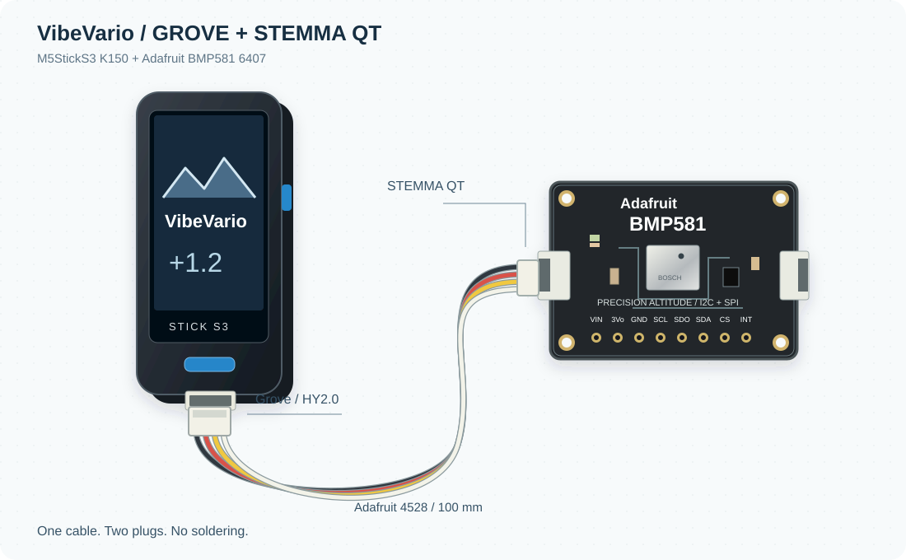
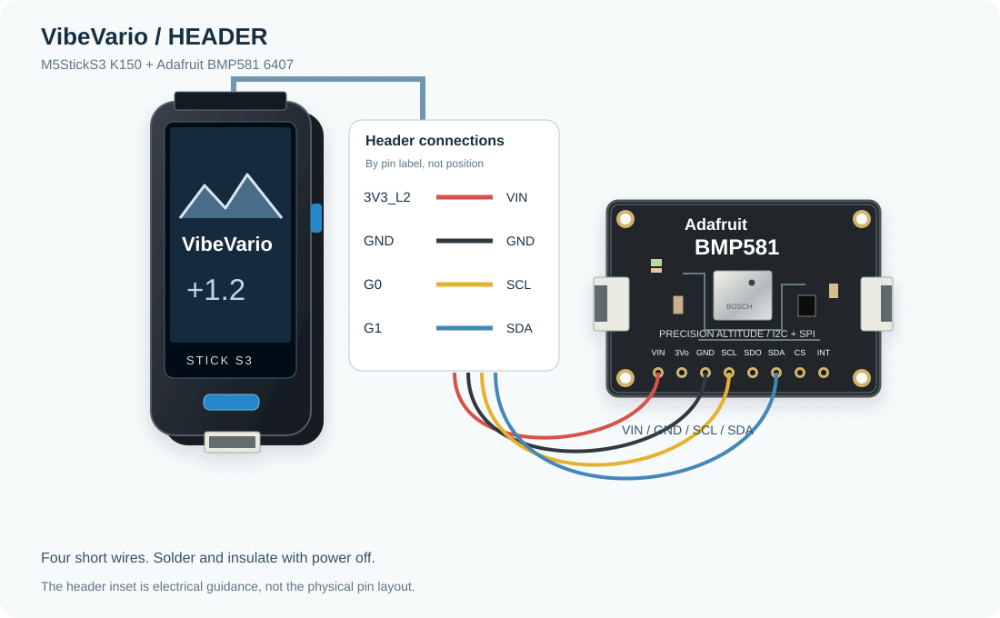

# Assembly

## A - Plug in one cable

1. Turn the Stick off and disconnect USB.
2. Plug the Grove end of the Adafruit4528 cable into the Stick's bottom Grove port.
3. Plug the small STEMMA QT end into the Adafruit BMP581.
4. Secure the sensor on an insulating support. Leave its pressure opening unobstructed.
5. Connect USB and follow [installation](installation.md).

The firmware tries Grove first: SDA G9, SCL G10, external5V enabled. The illustration
shows how the assembled parts fit together; it is not a mechanical drawing or a
promise that generic Grove/QT cables share the correct wiring.

## B - Short wires to the header

| StickS3 pin label | Adafruit BMP581 pin |
|---|---|
| 3V3_L2 | VIN |
| GND | GND |
| G1 | SDA |
| G0 | SCL |

Power the sensor from this connection only. Do not also feed it through Grove.
Use the printed pin names and the [official StickS3 pinout](https://docs.m5stack.com/en/core/StickS3):
the inset identifies electrical connections, not physical header positions.
Solder only with power disconnected, insulate joints and secure the wires.
G0 is also BOOT and must remain high during reset.

The firmware tries this bus after Grove. With the sensor on the header, it turns
external5V off and checks that the sensor remains powered. This option has been
used on the development prototype. The Grove port is then available for future use.

These are original component illustrations, not Fritzing library parts or exact
PCB layouts. Connector placement and electrical labels are intended to make the
assembly understandable; check the hardware markings before soldering.
