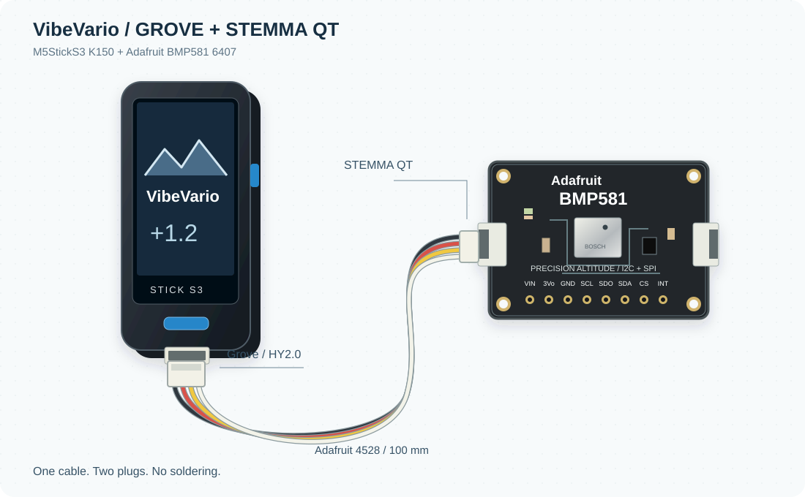

# VibeVario

## A vibe ~~coded~~ engineered variometer.

An open project by **Liuk_ITA**, built with AI assistance and refined through
measurements, filter comparisons and hands-on listening.

The goal is simple: an **open, reliable, precise variometer that is easy to assemble**.
A Bosch BMP581 on an Adafruit breakout connects to an M5StickS3; the display,
speaker and rechargeable battery are already built in. Major distributors stock
the core components, and the basic build needs one adapter cable and no soldering.

- [Choose the parts](components.md).
- [Connect the two boards](assembly.md).
- [Install and configure from the browser](installation.md).
- [Understand the controls and features](usage.md).
- [Read why it is built this way](design.md).

**Current status:** bench prototype, not flight validated. Acquisition, filtering,
audio and BLE telemetry have been exercised during development. Optional keyboard
pairing remains unresolved and internal-speaker audibility in flight needs testing.
