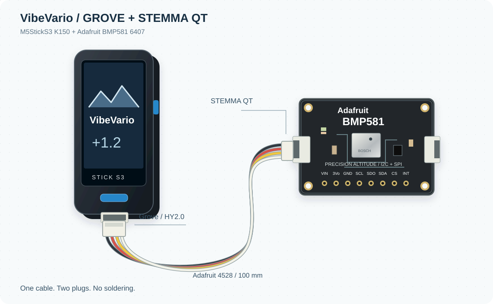
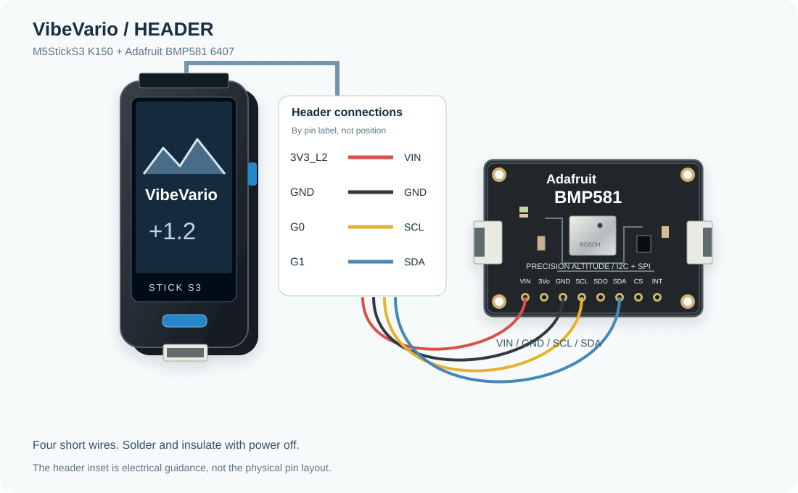

# Assemblaggio

## A - Grove, senza saldature

1. Spegnere e scollegare lo Stick prima del montaggio.
2. Inserire il lato Grove del cavo Adafruit4528 nella porta Grove dello Stick.
3. Inserire il lato STEMMA QT nella breakout Adafruit BMP581.
4. Fissare il sensore con un supporto isolante, lasciando libero il foro di pressione.
5. Collegare USB e caricare l'app seguendo [la guida](installation.md).

Il firmware cerca il BMP581 prima su Grove, con SDA G9/SCL G10 e5VEXT attiva.
Usare il cavo con piedinatura corretta; QT e Grove sono connettori diversi.
Questo percorso corrisponde al cablaggio Grove usato durante lo sviluppo; la
singola confezione commerciale del cavo suggerito va controllata al montaggio.

## B - Header, con fili corti

| StickS3, etichetta del pin | Breakout Adafruit BMP581 |
|---|---|
|3V3_L2|VIN|
|GND|GND|
|G1|SDA|
|G0|SCL|

Collegare solo questa alimentazione: evitare di alimentare anche dalla porta Grove.
Usare i nomi stampati e la [piedinatura ufficiale](https://docs.m5stack.com/en/core/StickS3),
non dedurre le posizioni fisiche dai disegni, che sono schemi logici.
Saldare a dispositivo spento, isolare le giunzioni e prevedere scarico di trazione.
G0 e anche il pinBOOT e deve restare alto durante il reset.

Il firmware prova header dopo Grove, quindi disabilita5VEXT se il BMP581 e trovato
su header. Questa variante e stata verificata sul prototipo. La porta Grove resta
libera; eventuali espansioni non sono necessarie per usare il variometro.

I disegni mostrano i componenti e i connettori in modo riconoscibile: sono illustrazioni originali, non fotografie, parti della libreria Fritzing o quote meccaniche.
