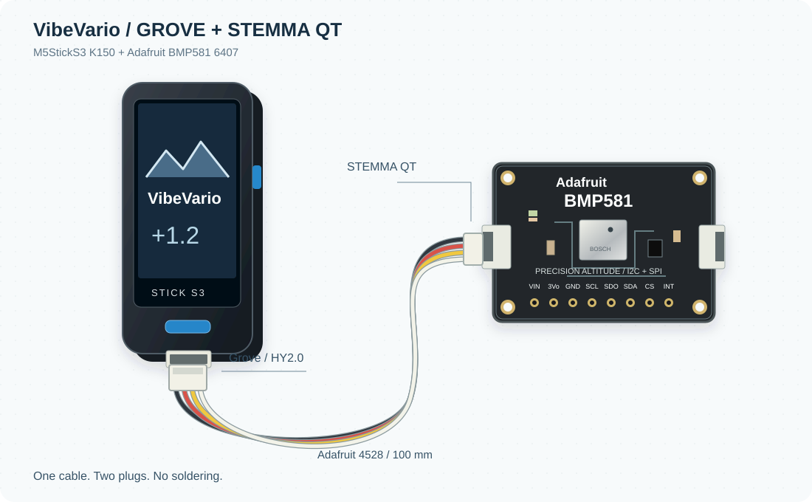

# VibeVario

## Un variometro vibe ~~coded~~ engineered.

Un progetto aperto di **Liuk_ITA**, sviluppato con assistenza AI e affinato con
misure, confronti tra filtri e prove di ascolto.

L'obiettivo e un variometro **open, affidabile, preciso e facile da assemblare**.
Il sensore Bosch BMP581 sulla breakout Adafruit si collega allo StickS3; display,
speaker e batteria sono gia integrati. I componenti principali si trovano presso
importanti distributori e il montaggio base richiede un solo cavo, senza saldature.

- [Scegli i componenti](components.md).
- [Assembla il dispositivo](assembly.md).
- [Installa e configura dal browser](installation.md).
- [Scopri comandi e funzioni](usage.md).
- [Leggi le scelte del progetto](design.md).

**Stato attuale:** prototipo da banco, non validato in volo. Acquisizione, filtri,
audio e telemetria sono stati provati durante lo sviluppo. La tastiera BLE rimane
un problema aperto; autonomia e udibilita in volo richiedono ancora prove.
